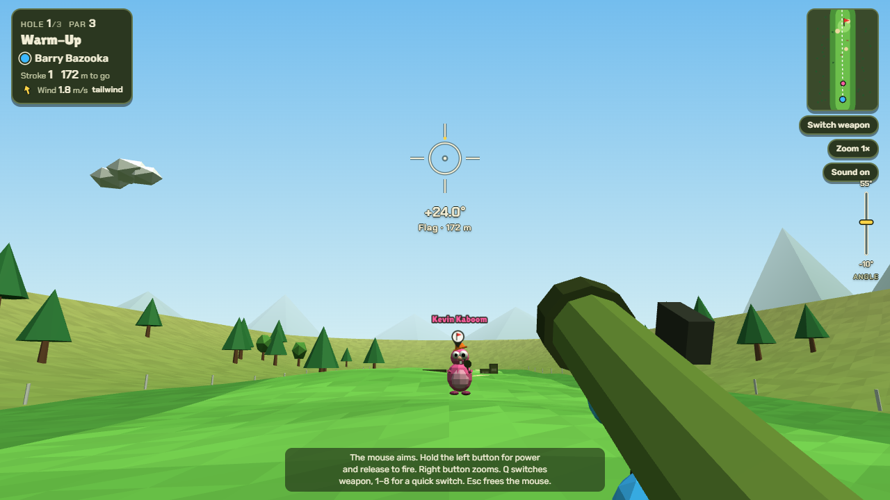
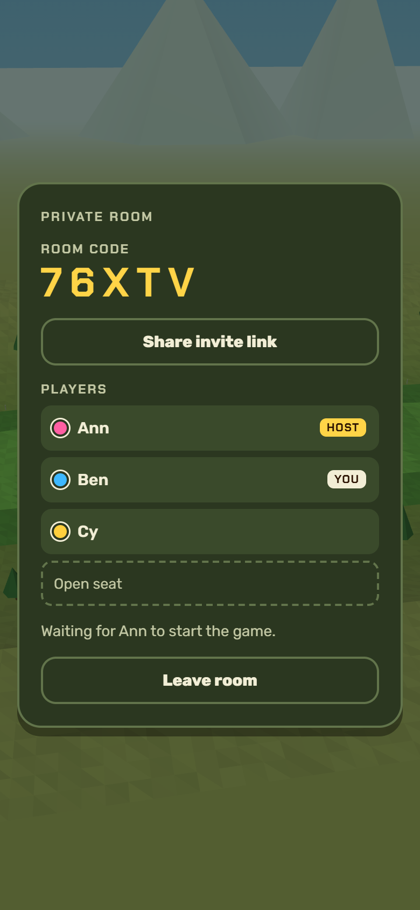
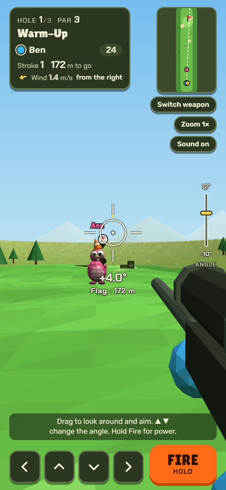
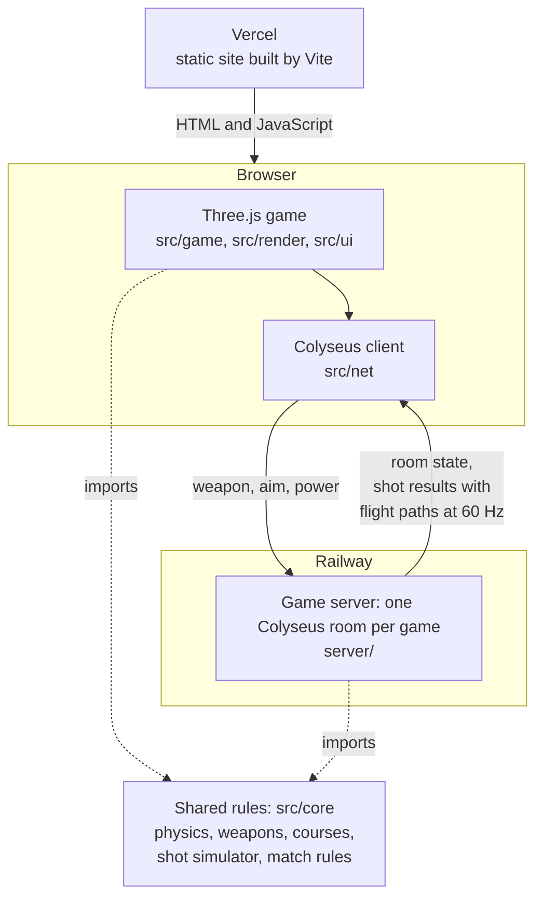

# Birdie Blasters

A silly first-person golf game where the clubs are guns. You stand where your shot lands, so the next player can shoot
you back toward the tee.

### [▶ Play now](https://birdie-blasters.vercel.app)

In the browser, on a computer or a phone: online with friends, or 1–4 players taking turns on one screen.



<p align="center">
  
  &nbsp;&nbsp;
  
</p>

## Features

- **Eight weapons, one per club.** Each has its own flight and a special effect:

  | Weapon | Club | Range | Effect |
  |---|---|---|---|
  | Bazooka | Driver | 230 m | Rocket motor; a tailwind adds even more. Explodes on landing and blasts nearby players away |
  | Grenade Launcher | 3-wood | 175 m | High arc; after its first bounce an energy burst sends it onward |
  | Sniper Rifle | Long iron | 160 m | Flat and precise; the 5× scope shows where the bullet will land |
  | Assault Rifle | Mid iron | 100 m | Fires three bullets on slightly different paths, and you pick the one that counts |
  | Shotgun | Short iron | 80 m | The slug is pulled toward the hole over the last 12 m |
  | Pistol | Wedge | 55 m | A little lift makes it float down softly and stop fast |
  | Flare Gun | Sand wedge | 35 m | Goes almost straight up; loses no power in sand or rough |
  | Dart Blaster | Putter | 35 m | The foam dart drops steeply and barely bounces |

- **First-person aiming** through your character's eyes, with a power meter that swings while you hold and a scope
  zoom on every weapon.
- **Shoot your friends:** a body hit knocks a player 40 m back down the course, and a headshot sends them back to the tee.
- **Wind** that changes from hole to hole; sand and rough cost power; water and out of bounds cost a stroke. Three
  holes: Warm-Up, Duck Pond and The Fortress.
- **Online play** in private rooms: a five-character code and an invite link (the share sheet on phones, the clipboard on
  computers), a lobby for up to four players, and "Play again" at the end.
- **A 30-second shot clock** with a turn alert, and the other players watch the shooter aim live.
- **Reconnects:** a player who reloads or loses the network keeps their seat for 60 seconds and reconnects by itself;
  their turns are skipped meanwhile.
- **Desktop and mobile:** mouse with pointer lock and keyboard, or touch.

## Controls

| | Mouse and keyboard | Touch |
|---|---|---|
| Aim | Click the course to lock the mouse, then move it. Arrow keys turn and tilt | Drag on the course; the arrow buttons turn and tilt |
| Power and fire | Hold the left button or Space, release to fire | Hold **Fire**, release to fire |
| Zoom | Right button, mouse wheel or Z | **Zoom** button |
| Switch weapon | Q opens the golf bag; 1–8 picks a weapon | **Switch weapon**, then tap one |
| Pick the rifle bullet that counts | 1–3, or click its numbered button | Tap its numbered button |
| Scorecard | Click the hole card | Tap the hole card |

Esc frees the mouse.

## Tech stack

| | |
|---|---|
| Game | [Three.js](https://threejs.org/), plain JavaScript (ES modules), sound synthesised with the Web Audio API, built with [Vite](https://vite.dev/) |
| Game server | [Node.js](https://nodejs.org/) and [Colyseus](https://colyseus.io/) (rooms and state sync over WebSockets) |
| Tests | [Vitest](https://vitest.dev/); browser flows scripted in headless Edge |
| Hosting | [Vercel](https://vercel.com/) for the site, [Railway](https://railway.com/) for the game server (Docker) |

## Architecture

The rules live in `src/core/`: physics, weapons, courses, the shot simulator and the match rules (turns, strokes, wind,
holes, timeouts, disconnects). It is plain JavaScript with no Three.js, DOM or `Math.random`, so the same files run in the
browser and on the server. A one-screen game runs the match in the browser; online, the server runs it and the browser
only shows it.



- **The server decides every shot.** Browsers send only the weapon, aim and power. The server rolls the random spread,
  simulates the whole shot, applies the rules and sends everyone the result. A modified client cannot fake a hole in
  one, and every screen agrees on where everyone stands.
- **Flight paths are sent as sampled points.** Each projectile's path goes out sampled at 60 Hz, with a list of events
  (bounce, burst, explosion, hit), instead of every browser re-running the physics. `Math.sin` and friends may differ in
  the last digit between JavaScript engines, and bounces magnify that until a replay ends somewhere else than the
  server decided. Replaying the points shows every player exactly the shot the server decided.
- **Golden shot tests protect how the game plays.** Before the physics moved into the shared simulator, 206 seeded
  shots from the original prototype were recorded, covering every outcome: rest, cup, water, out of bounds, body hit,
  headshot, blast, burst, rifle choice and picked up. The simulator and the match must reproduce them byte for byte, so
  refactoring, and moving the rules to the server, cannot change a single shot.

## Testing

`npm test` runs 506 tests with Vitest:

- **Golden shots (416):** each of the 206 recorded shots checked for its launch and its outcome, and all of them played
  through the match.
- **Match rules (26):** turns, penalties, the shot clock, disconnects and leaving, and a scripted three-hole game.
- **Game server (51):** boots a real Colyseus server and plays through the browser client: private rooms and codes,
  the lobby, turned-down requests, shots, the shot clock, reconnects, whole games with two to four players, live aim,
  the room limit per IP, CORS and the health check.
- **Protocol and purity (13):** room codes, nicknames and shot packing, and a check that `src/core/` imports nothing
  from Three.js or the browser and never uses `Math.random`.

Browser flows (two to three players, desktop and phone-sized screens, reloads and lost connections) were checked with
scripted headless Edge sessions, and the deployed game was playtested on phones over mobile data.

## Running it locally

Needs Node.js 22 or newer.

```bash
npm install          # also installs the server workspace
npm run dev:server   # game server on ws://localhost:2567
npm run dev          # the game on http://localhost:5173
npm test
```

To play on a phone on the same Wi-Fi, run `npm run dev -- --host` and open the Network address Vite prints.
`npm run build` makes the production site, which talks to the hosted game server (`.env.production`).

```
src/core/     rules shared with the server: physics, weapons, courses, shot simulator, match rules, protocol
src/game/     plays the match on screen: turns, shots, following an online room
src/render/   Three.js: scene, course, characters, camera, effects
src/ui/       HUD, golf bag, reticle, minimap, scorecard, lobby, input
src/net/      talking to the game server
src/audio/    synthesised sound effects
server/       the Colyseus game server (an npm workspace) and its tests
tests/        rules, simulator and golden shot tests
docs/         the online multiplayer plan and known issues
```

## How it was built

Birdie Blasters was built with AI coding tools (Claude Code). The idea, the game design and the decision to make the server authoritative are mine: a modified client should not be able to fake a hole in one, and every screen should agree on where everyone stands. The implementation decisions that follow from it came out of planning and reviewing the work with the tool.

I drove the project through fourteen planned steps, each with its own test, playtested it on desktop and on phones over mobile data, and deployed it: [docs/online-plan.md](docs/online-plan.md) holds the requirements,
every decision and why it was made, and how each step was checked. It is an example of how I plan work.
